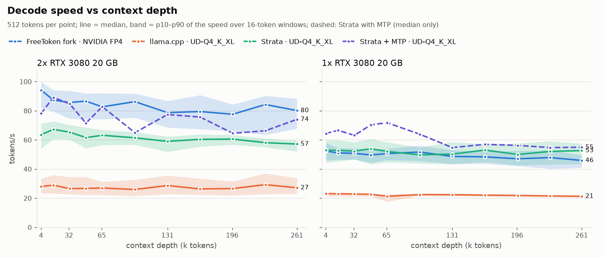
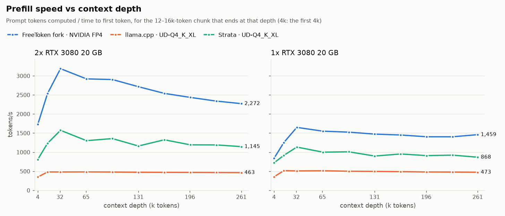
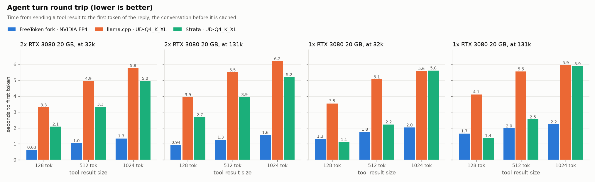

# FreeToken fork for Qwen3.8-Flash-Next on 1-2 GPUs

Optimized for **Qwen3.8-Flash-Next** if you have 96GB+ RAM and 1-2 GPUs.

Recommended to use with Nvidia's [QAD FP4 quant](https://huggingface.co/nvidia/Qwen3.8-Flash-Next-FP4-Local). But it also supports Intel's [INT4 W4A16](https://huggingface.co/Intel/Qwen3.8-Flash-Next-W4A16-AutoRound)

MoE experts are pinned to host RAM. There's no setting for context length. As a session's used context grows, it dynamically allocates more KV cache. All the remaining free VRAM is used for MoE expert cache to speed up decode. 

## Benchmarks

FP4 with default settings: RTX 3080s on PCIe 4.0 x8, 96 GB of DDR5. For 16GB tests I just limited my 3080 20GB to max 16GB used. Both 3080s have unlocked ReBAR and P2P.

### **One GPU at PCIe 4.0 x8**

| GPU | Prefill batch | Decode | 16k prefill | Max context (F16) |
|---|---|---|---|---|
| 16 GB | **8192** | 51 tok/s | **1,530 tok/s** | 147k |
| 16 GB | 4096 | 52 tok/s | 800 tok/s | 186k |
| 16 GB | 2048 | 52 tok/s | 900 tok/s | **205k** |
| 20 GB | **8192** | 56 tok/s | **1,610 tok/s** | **262k** |
| 20 GB | 4096 | 57 tok/s | 850 tok/s | 262k |

### **Two GPUs at PCIe 4.0 x8**

| GPU | Prefill batch | Decode | 16k prefill | Max context (F16) |
|---|---|---|---|---|
| 2x 16 GB | 8192 | 82 tok/s | 2,760 tok/s | 262k |
| 2x 20 GB | 8192 | 93 tok/s | 3,030 tok/s | 262k |

- **RAM:** the experts stay pinned in host RAM: 64 GiB for FP4, 59 GiB for INT4. You will need 96 GB or more RAM to use this.
- **One GPU** decode is CPU-assisted: the CPU computes most of the experts missing from VRAM. These rows use this PC's calibrated split (`--moe-decode-fetch 0.15 --moe-cpu-decode-threads 7`); the 16 GB rows reuse the 20 GB card's calibration. With `--moe-decode-fetch 1` (no CPU help) one GPU decodes at 34 tok/s (20 GB) and 27 tok/s (16 GB).
- **INT4** downloads 169 GB instead of 96 GB. It decodes about 11% slower on two GPUs, and gets no CPU-assisted decode on one GPU.
- **Two GPUs** were measured with P2P between them (patched driver); without P2P, expect about 8% less decode.
- **PCIe 4.0 x8:** all tests done on PCIe 4.0 x8, even single-GPU tests. If you have 4.0 x16 or even PCIe 5.0 x16, you should have much better decode and prefill.

### Compared with llama.cpp and Strata

FreeToken runs NVIDIA's FP4; [llama.cpp](https://github.com/ggml-org/llama.cpp) (b11941) and [Strata](https://github.com/Niko1221/Strata) (0.2.7) run unsloth's [UD-Q4_K_XL](https://huggingface.co/unsloth/Qwen3.8-Flash-Next-GGUF) GGUF. 262k 16-bit KV cache, no MTP, single request.

<picture>
  <source media="(prefers-color-scheme: dark)" srcset="assets/bench/decode-dark.png">
  
</picture>

<picture>
  <source media="(prefers-color-scheme: dark)" srcset="assets/bench/prefill-dark.png">
  
</picture>

<picture>
  <source media="(prefers-color-scheme: dark)" srcset="assets/bench/roundtrip-dark.png">
  
</picture>

**Settings**
- **FreeToken:** `scripts/serve.sh` defaults, with `GPUS=0` for one GPU. On one GPU that includes CPU-assisted decode with the calibrated `--moe-decode-fetch 0.15 --moe-cpu-decode-threads 7`.
- **llama.cpp on 2 GPUs:** `-cmoe --moe-cache-mib 16000 -ub 4096 -b 4096 -ts 1,1 -fa on -lm none`.
  - `-ub 2048` with a 20 GB cache decoded about 20% faster but prefilled 37% slower.
  - Without moe-cache-mib, decode was 16 tok/s.
- **llama.cpp on 1 GPU:** `-cmoe -ub 4096 -b 4096 -fa on -lm none`, with no MoE cache. A 4 GB cache made decode slower (13.5 vs 22 tok/s).
- **Strata:** setup's config for UD-Q4_K_XL, with every expert in RAM and KV beyond 32k streamed from RAM.
  - MTP off, `STRATA_ROUTE_TAIL_SKIP=0` and `STRATA_ROUTE_PRIOR=0` - these options improve speed but reduce model quality.
  - `--spec 2 --suffix-draft 0`: native packs need a 2-token verify window, and it made no drafts.
  - The dashed line is Strata with its MTP draft layer (setup's `--spec 4 --spec-min-p 0.5`), for reference.

## Quick start

Linux, CUDA 13 with `nvcc`, 96 GB of RAM; an AVX-512 BF16 CPU speeds up prefill ([details](scripts/README.md#requirements)).

```bash
git clone https://github.com/grumd/freetoken && cd freetoken
uv venv && source .venv/bin/activate
uv pip install -e ".[accel]"

hf download nvidia/Qwen3.8-Flash-Next-FP4-Local --local-dir ~/models/q38-fp4-hf
ft checkpoint --model ~/models/q38-fp4-hf --out ~/models/ftw/q38-fp4   # one-time fast-load conversion
MODEL=~/models/ftw/q38-fp4 scripts/serve.sh                      # API on :8080, chat page at /
```

`serve.sh` uses every GPU it finds, up to two. On one GPU the CPU computes most of the experts missing from VRAM while the GPU runs the rest (`--moe-decode-fetch 0.1`). `scripts/calibrate.sh` measures the best split for your CPU, RAM and PCIe link (~12 min) and prints the flags to pass to `serve.sh`. Two GPUs don't need it: there the CPU doesn't help ([details](scripts/README.md#calibratesh-cpu-assisted-decode-fp4)).

For INT4, download `Intel/Qwen3.8-Flash-Next-W4A16-AutoRound` instead.

The default settings should already be optimized, and the context size and expert cache size automatically match your free VRAM.

- you need more than 147k tokens on one 16 GB GPU: pass `--max-prefill-length 4096` (or 2048) after the script name (see benchmarks above)
- you have 128 GB of RAM: `PREFIX_CACHE_RAM_GB=16` keeps older chat sessions in RAM, so going back to an old chat can skip prefilling from scratch

See [`scripts/README.md`](scripts/README.md) for more details about options.

## What this fork adds

- Experts in pinned host RAM behind a VRAM expert cache that grows and shrinks with the live context
- Hybrid prefill: short chunks load only their routed experts, and the CPU computes cache misses while the GPU fetches the rest
- CPU-assisted decode on one GPU: the CPU computes most VRAM-cache misses instead of copying them over PCIe, with a one-time calibration script for the split
- W4A16 and NVFP4 kernels tuned for RTX 30-series, and a two-GPU all-reduce over P2P or shared host memory
- NVIDIA's FP4-Local checkpoint, the vision tower on the CPU, and a chat page at `/`
- An optional host-RAM tier for old conversations' prefixes

Each change with its commit and measured effect: [`docs/fork-changes.md`](docs/fork-changes.md).

## For contributors

- Read [`AGENTS.md`](AGENTS.md) first; its "Caveats to revisit for new models" lists what the CPU prefill kernels hardcode.
- Tests: `uv run pytest tests/ -m "not slow"`. About 19 tests (DeepSeek-V4/Engram, rotary, GLM, QSA chunked prefill, scheduler accounting) already failed before the FP4 commits, and some are order-dependent, so compare whole-suite runs.
- A/B with `FREETOKEN_WNA16_CPU_PREFILL=0` and `--moe-decode-fetch 1`: CPU prefill and CPU-assisted decode are not bit-reproducible.
- After editing `kernel/csrc/`, run `python setup.py build_ext --inplace`. Re-run `ft checkpoint` after changing a quant format.

## Citation & Acknowledgment

FreeToken (upstream). Please cite the original paper:

```bibtex
@article{yang2026freetoken,
  title={FreeToken: Efficient Edge-Native MoE Serving with Bandwidth-Adaptive Execution},
  author={Yang, Shuo and Fan, Xiaoze and Pan, Melissa and Xi, Haocheng and Wang, Zhe and Sun, Shanlin and Keutzer, Kurt and Han, Song and Zaharia, Matei and Xu, Chenfeng and Stoica, Ion},
  journal={arXiv preprint arXiv:2608.16157},
  year={2026}
}
```

FreeToken was deeply inspired by [mini-sglang](https://github.com/sgl-project/mini-sglang), and
learned the design and reused code from [SGLang](https://github.com/sgl-project/sglang),
[vLLM](https://github.com/vllm-project/vllm),
[FlashInfer](https://github.com/flashinfer-ai/flashinfer),
[flash-linear-attention](https://github.com/fla-org/flash-linear-attention),
[LightLLM](https://github.com/ModelTC/lightllm) and [llama.cpp](https://github.com/ggml-org/llama.cpp).

Licensed under Apache-2.0 ([`LICENSE`](LICENSE)).
