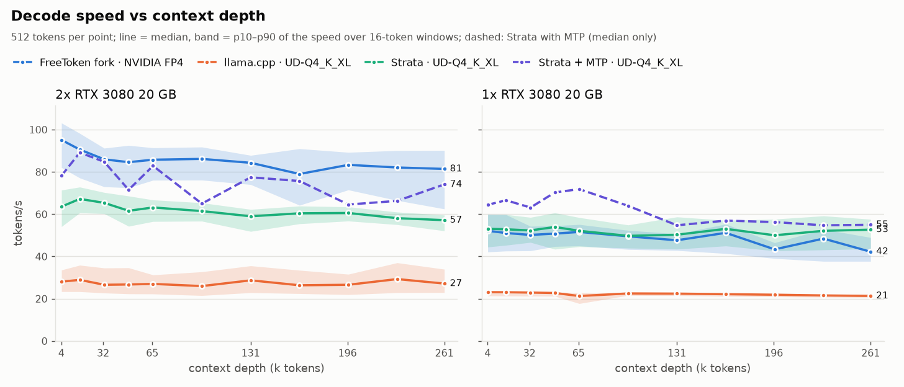
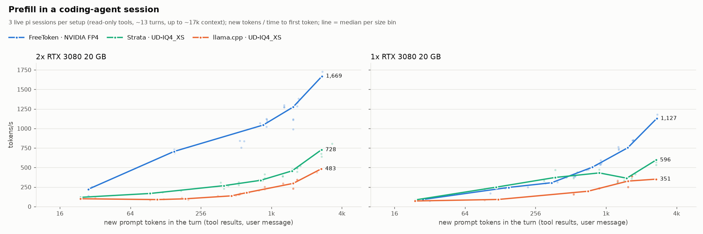

# FreeToken fork for Qwen3.8-Flash-Next on 1-2 GPUs

Optimized for **Qwen3.8-Flash-Next** if you have 96GB+ RAM and one or two RTX 3080 20 GB-class GPUs.

Recommended to use with Nvidia's [QAD FP4 quant](https://huggingface.co/nvidia/Qwen3.8-Flash-Next-FP4-Local). But it also supports Intel's [INT4 W4A16](https://huggingface.co/Intel/Qwen3.8-Flash-Next-W4A16-AutoRound)

MoE experts are pinned to host RAM. There's no setting for context length. As a session's used context grows, it dynamically allocates more KV cache. All the remaining free VRAM is used for MoE expert cache to speed up decode. 

## Benchmarks

Nvidia FP4, `scripts/serve.sh` defaults.

| Setup | Decode | + MTP | 16k prefill (first / warm) | Max context |
|---|---|---|---|---|
| 1x RTX 3080 20 GB | 55 tok/s | 60 tok/s | 2,660 / 2,720 tok/s | 262k |
| 2x RTX 3080 20 GB | 91 tok/s | 102 tok/s | 3,390 / 3,500 tok/s | 262k |

- **Hardware:** each card on PCIe 4.0 x8, with P2P enabled; Ryzen 7 9800X3D; 96 GB DDR5. A x16 or PCIe 5.0 link should be faster.
- **Decode:** a 1024-token reply to a prose prompt at temperature 1.0, mean of 3. On one GPU the CPU computes most experts missing from VRAM (`--moe-decode-fetch 0.1`). MTP uses temp 1.0.
- **RAM:** the experts stay pinned in host RAM (64 GiB for FP4), so you need 96 GB or more.

### MTP speculative decoding

The checkpoint's MTP head drafts tokens and the model checks them in one pass; the output is unchanged (lossless). It's off by default; add these flags to `scripts/serve.sh` to turn it on:

| Setup | Flags |
|---|---|
| 1x 20 GB | `--mtp on --mtp-experts-fp4 --mtp-draft-tokens 2` |
| 2x 20 GB | `--mtp on --mtp-experts-fp4 --moe-decode-fetch 0.5` |

- **`--mtp-experts-fp4`:** stores the draft head's experts in NVFP4, reduces VRAM usage, leaving more VRAM for MoE expert cache.
- **`--moe-decode-fetch 0.5`:** Share of expert-cache misses the CPU computes. On one GPU, my best setting was 0.1 (default); 0.5 gives better results on 2x 3080 20GB. The best value will depend on your system.
- **`--mtp-draft-tokens`:** draft length, 3 by default. On one GPU, 2 is faster.
- **One GPU prefill on long prompts:** the MTP head takes VRAM, so past ~160k of context a 16k-token prompt chunk prefills slower than without MTP (907 vs 1,603 tok/s at 261k). Two GPUs lose under 10%.

### Compared with llama.cpp and Strata

Single request, 262k context with a 16-bit KV cache. FreeToken runs NVIDIA's FP4; [llama.cpp](https://github.com/ggml-org/llama.cpp) (build 12428) and [Strata](https://github.com/Niko1221/Strata) (0.2.9) run unsloth's [UD-IQ4_XS](https://huggingface.co/unsloth/Qwen3.8-Flash-Next-GGUF) GGUF.

<picture>
  <source media="(prefers-color-scheme: dark)" srcset="assets/bench/decode-dark.png">
  
</picture>

<picture>
  <source media="(prefers-color-scheme: dark)" srcset="assets/bench/prefill-dark.png">
  
</picture>

<picture>
  <source media="(prefers-color-scheme: dark)" srcset="assets/bench/agent-dark.png">
  
</picture>

**Quality:** KL divergence from the BF16 model's logits ([jyohukuchan/qwen38-flash-next-bf16-logits](https://huggingface.co/datasets/jyohukuchan/qwen38-flash-next-bf16-logits)).

| Engine · quant | KLD | Same top token |
|---|---|---|
| Strata · UD-Q4_K_XL | 0.078 | 92.6% |
| FreeToken · NVIDIA FP4 + BF16 PLE table (benchmarked above) | 0.096 | 91.4% |
| llama.cpp · UD-Q4_K_XL | 0.100 | 91.9% |
| FreeToken · NVIDIA FP4 + included PLE table | 0.109 | 91.0% |
| Strata · UD-Q3_K_XL | 0.116 | 90.1% |
| Strata · UD-IQ4_XS | 0.118 | 90.3% |

- FreeToken with MTP scores the same as without (0.095).
- The PLE table is a per-layer token embedding read from disk; NVIDIA's checkpoint stores it in NVFP4, the benchmarks above swap in the BF16 table from Intel's checkpoint.

**Settings**
- **FreeToken:** `scripts/serve.sh` defaults, `GPUS=1` for one GPU; MTP with the flags above.
- **llama.cpp on 2 GPUs:** `-cmoe --moe-cache-mib 16000 --moe-cache-cpu-share 0.9 -ub 4096 -b 4096 -ts 1,1 -fa on -lm none`. Without `--moe-cache-cpu-share` it decoded at 42 instead of 52-54 tok/s.
- **llama.cpp on 1 GPU:** `-cmoe --moe-cache-mib 5000 --moe-cache-cpu-share 0.9 -ub 2048 -b 2048 -fa on -lm none`.
- **Strata:** setup's config for the unsloth files: every expert in RAM, KV beyond 32k streamed from RAM, `--spec 4` with its prompt-lookup drafts (FreeToken's `--ngram-spec` is on too), `STRATA_ROUTE_TAIL_SKIP=0` (the default skips some experts: faster, lower quality).
  - MTP: setup's draft layer (`--mtp <draft layer> --spec 4 --spec-min-p 0.5`).

## Quick start

Linux, CUDA 13 with `nvcc`, 96 GB of RAM; an AVX-512 BF16 CPU speeds up prefill ([details](scripts/README.md#requirements)).

```bash
git clone https://github.com/grumd/freetoken && cd freetoken
uv venv && source .venv/bin/activate
uv pip install -e ".[accel]"

hf download nvidia/Qwen3.8-Flash-Next-FP4-Local --local-dir ~/models/q38-fp4-hf
ft checkpoint --model ~/models/q38-fp4-hf --out ~/models/ftw/q38-fp4   # one-time fast-load conversion
MODEL=~/models/ftw/q38-fp4 scripts/serve.sh                      # API on :8080, chat page at /
```

For INT4, download `Intel/Qwen3.8-Flash-Next-W4A16-AutoRound` instead (169 GB; FP4 is faster).

## Configuration

The defaults fit most setups. Context and expert cache size themselves to your free VRAM; there is no context-length setting.

| To | Do |
|---|---|
| Pick GPUs | `GPUS=1 scripts/serve.sh` (default: every GPU, up to two) |
| Decode faster with MTP | add the flags for your setup from [MTP speculative decoding](#mtp-speculative-decoding) |
| Tune CPU-assisted decode (one GPU) | run `scripts/calibrate.sh` once (~12 min) and pass the flags it prints |
| Keep old chats in RAM (128 GB machines) | `PREFIX_CACHE_RAM_GB=16 scripts/serve.sh` |
| Trade a little accuracy for +5% decode (one GPU) | `scripts/serve.sh --dense-mxfp8-groups lm_head` (lossy, off by default) |

Prefill chunks: `--prefill-batch-min` (2048) tokens of activation VRAM are always reserved. Longer prompts borrow what their chunk needs from the expert cache, up to `--prefill-batch-max` (16384) tokens, and give it back before decoding.

Every setting: [`scripts/README.md`](scripts/README.md).

## What this fork adds

- Experts in pinned host RAM behind a VRAM expert cache that grows and shrinks with the live context
- Hybrid prefill: chunks up to 4096 tokens (3072 on two GPUs) load only their routed experts, and the CPU computes part of the cache misses while the GPU fetches the rest
- Prefill takes only the VRAM each prompt needs and keeps decode's experts cached, so agent turns start fast
- CPU-assisted decode on one GPU: the CPU computes most VRAM-cache misses instead of copying them over PCIe, with a one-time calibration script for the split
- MTP speculative decoding with the checkpoint's own head (opt-in, `--mtp on`): sampled drafts, CUDA-graphed draft/verify/commit, lossless; +17-24% decode at temperature 1.0
- Prompt-lookup speculative decoding (`--ngram-spec`, on in `serve.sh`): lossless, no draft model; +55-61% decode when the reply repeats its context (code edits), about even on prose
- Opt-in MXFP8 for more dense layers (`--dense-mxfp8-groups lm_head`): +5% decode on one GPU, KLD within run-to-run noise; off by default because it rounds the weights
- W4A16 and NVFP4 kernels tuned for RTX 30-series, and a two-GPU all-reduce over P2P or shared host memory
- NVIDIA's FP4-Local checkpoint, the vision tower on the CPU, and a chat page at `/`
- An optional host-RAM tier for old conversations' prefixes

Each change with its commit and measured effect: [`docs/fork-changes.md`](docs/fork-changes.md).

## For contributors

- Read [`AGENTS.md`](AGENTS.md) first; its "Caveats to revisit for new models" lists what the CPU prefill kernels hardcode.
- Tests: `uv run pytest tests/ -m "not slow"`. About 19 tests (DeepSeek-V4/Engram, rotary, GLM, QSA chunked prefill, scheduler accounting) already failed before the FP4 commits, and some are order-dependent, so compare whole-suite runs.
- A/B with `--moe-prefill-fetch 1` and `--moe-decode-fetch 1`: CPU prefill and CPU-assisted decode are not bit-reproducible.
- After editing `kernel/csrc/`, run `python setup.py build_ext --inplace`. Re-run `ft checkpoint` after changing a quant format.

## Citation & Acknowledgment

FreeToken (upstream). Please cite the original paper:

```bibtex
@article{yang2026freetoken,
  title={FreeToken: Efficient Edge-Native MoE Serving with Bandwidth-Adaptive Execution},
  author={Yang, Shuo and Fan, Xiaoze and Pan, Melissa and Xi, Haocheng and Wang, Zhe and Sun, Shanlin and Keutzer, Kurt and Han, Song and Zaharia, Matei and Xu, Chenfeng and Stoica, Ion},
  journal={arXiv preprint arXiv:2608.16157},
  year={2026}
}
```

FreeToken was deeply inspired by [mini-sglang](https://github.com/sgl-project/mini-sglang), and
learned the design and reused code from [SGLang](https://github.com/sgl-project/sglang),
[vLLM](https://github.com/vllm-project/vllm),
[FlashInfer](https://github.com/flashinfer-ai/flashinfer),
[flash-linear-attention](https://github.com/fla-org/flash-linear-attention),
[LightLLM](https://github.com/ModelTC/lightllm) and [llama.cpp](https://github.com/ggml-org/llama.cpp).

Licensed under Apache-2.0 ([`LICENSE`](LICENSE)).
