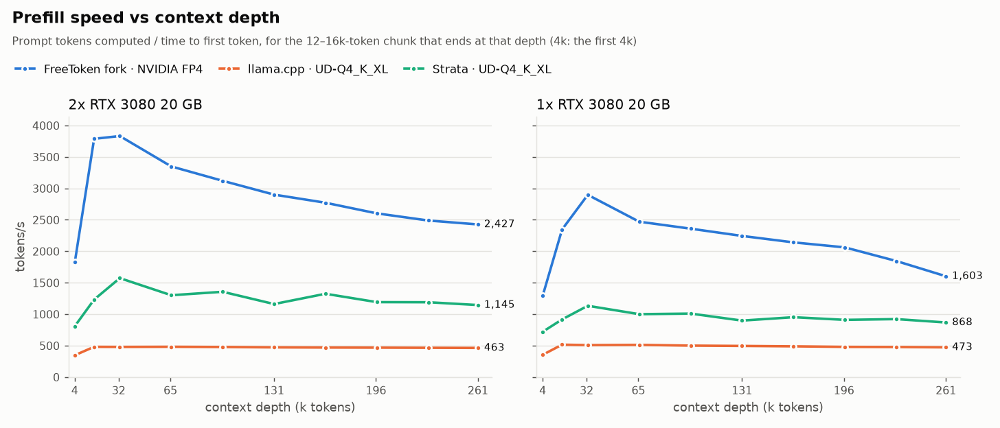
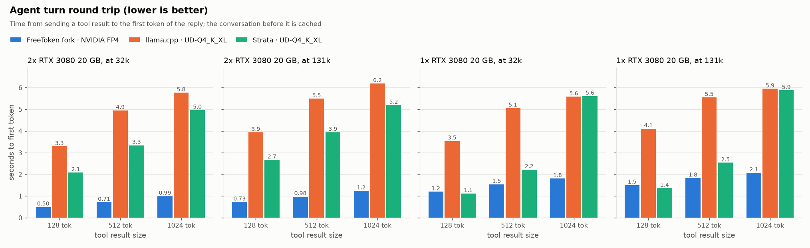

# FreeToken fork for Qwen3.8-Flash-Next on 1-2 GPUs

Optimized for **Qwen3.8-Flash-Next** if you have 96GB+ RAM and 1-2 GPUs.

Recommended to use with Nvidia's [QAD FP4 quant](https://huggingface.co/nvidia/Qwen3.8-Flash-Next-FP4-Local). But it also supports Intel's [INT4 W4A16](https://huggingface.co/Intel/Qwen3.8-Flash-Next-W4A16-AutoRound)

MoE experts are pinned to host RAM. There's no setting for context length. As a session's used context grows, it dynamically allocates more KV cache. All the remaining free VRAM is used for MoE expert cache to speed up decode. 

## Benchmarks

FP4, `scripts/serve.sh` defaults, measured 2026-11-15.

| Setup | Decode | 16k prefill (first / warm) | Max context |
|---|---|---|---|
| 1x 16 GB | 49 tok/s | 2,450 / 2,720 tok/s | 208k |
| 1x 20 GB | 54 tok/s | 2,590 / 2,720 tok/s | 262k |
| 2x 16 GB | 75 tok/s | 3,230 / 3,450 tok/s | 262k |
| 2x 20 GB | 89 tok/s | 3,240 / 3,470 tok/s | 262k |

- **Hardware:** RTX 3080 20 GB cards, each on PCIe 4.0 x8, with P2P between them; Ryzen 7 9800X3D; 96 GB DDR5. A "16 GB" GPU is a 20 GB card with 4 GB held. A x16 or PCIe 5.0 link should be faster.
- **Decode:** a 1024-token reply to a prose prompt. On one GPU the CPU computes most experts missing from VRAM (`--moe-decode-fetch 0.1`).
- **16k prefill:** a 16,003-token prompt. "First" is the first prompt after start; "warm" is a later one.
- **RAM:** the experts stay pinned in host RAM (64 GiB for FP4), so you need 96 GB or more.

### Compared with llama.cpp and Strata

FreeToken measured 2026-11-15, llama.cpp and Strata 2026-10-28. FreeToken runs NVIDIA's FP4; [llama.cpp](https://github.com/ggml-org/llama.cpp) (b11941) and [Strata](https://github.com/Niko1221/Strata) (0.2.7) run unsloth's [UD-Q4_K_XL](https://huggingface.co/unsloth/Qwen3.8-Flash-Next-GGUF) GGUF. 262k 16-bit KV cache, no MTP, single request.

<picture>
  <source media="(prefers-color-scheme: dark)" srcset="assets/bench/decode-dark.png">
  
</picture>

<picture>
  <source media="(prefers-color-scheme: dark)" srcset="assets/bench/prefill-dark.png">
  
</picture>

<picture>
  <source media="(prefers-color-scheme: dark)" srcset="assets/bench/roundtrip-dark.png">
  
</picture>

**Settings**
- **FreeToken:** `scripts/serve.sh` defaults, with `GPUS=0` for one GPU.
- **llama.cpp on 2 GPUs:** `-cmoe --moe-cache-mib 16000 -ub 4096 -b 4096 -ts 1,1 -fa on -lm none`.
  - `-ub 2048` with a 20 GB cache decoded about 20% faster but prefilled 37% slower.
  - Without moe-cache-mib, decode was 16 tok/s.
- **llama.cpp on 1 GPU:** `-cmoe -ub 4096 -b 4096 -fa on -lm none`, with no MoE cache. A 4 GB cache made decode slower (13.5 vs 22 tok/s).
- **Strata:** setup's config for UD-Q4_K_XL, with every expert in RAM and KV beyond 32k streamed from RAM.
  - MTP off, `STRATA_ROUTE_TAIL_SKIP=0` and `STRATA_ROUTE_PRIOR=0` - these options improve speed but reduce model quality.
  - `--spec 2 --suffix-draft 0`: native packs need a 2-token verify window, and it made no drafts.
  - The dashed line is Strata with its MTP draft layer (setup's `--spec 4 --spec-min-p 0.5`), for reference.

## Quick start

Linux, CUDA 13 with `nvcc`, 96 GB of RAM; an AVX-512 BF16 CPU speeds up prefill ([details](scripts/README.md#requirements)).

```bash
git clone https://github.com/grumd/freetoken && cd freetoken
uv venv && source .venv/bin/activate
uv pip install -e ".[accel]"

hf download nvidia/Qwen3.8-Flash-Next-FP4-Local --local-dir ~/models/q38-fp4-hf
ft checkpoint --model ~/models/q38-fp4-hf --out ~/models/ftw/q38-fp4   # one-time fast-load conversion
MODEL=~/models/ftw/q38-fp4 scripts/serve.sh                      # API on :8080, chat page at /
```

For INT4, download `Intel/Qwen3.8-Flash-Next-W4A16-AutoRound` instead (169 GB; FP4 is faster).

## Configuration

The defaults fit most setups. Context and expert cache size themselves to your free VRAM; there is no context-length setting.

| To | Do |
|---|---|
| Pick GPUs | `GPUS=1 scripts/serve.sh` (default: every GPU, up to two) |
| Tune CPU-assisted decode (one GPU) | run `scripts/calibrate.sh` once (~12 min) and pass the flags it prints |
| Keep old chats in RAM (128 GB machines) | `PREFIX_CACHE_RAM_GB=16 scripts/serve.sh` |
| Get ~9k more context on 16 GB | `scripts/serve.sh --prefill-batch-min 1024` |
| Trade a little accuracy for +5% decode (one GPU) | `scripts/serve.sh --dense-mxfp8-groups lm_head` (lossy, off by default) |

Prefill chunks: `--prefill-batch-min` (2048) tokens of activation VRAM are always reserved. Longer prompts borrow what their chunk needs from the expert cache, up to `--prefill-batch-max` (16384) tokens, and give it back before decoding.

Every setting: [`scripts/README.md`](scripts/README.md).

## What this fork adds

- Experts in pinned host RAM behind a VRAM expert cache that grows and shrinks with the live context
- Hybrid prefill: chunks up to 4096 tokens (3072 on two GPUs) load only their routed experts, and the CPU computes part of the cache misses while the GPU fetches the rest
- Prefill takes only the VRAM each prompt needs and keeps decode's experts cached, so agent turns start fast
- CPU-assisted decode on one GPU: the CPU computes most VRAM-cache misses instead of copying them over PCIe, with a one-time calibration script for the split
- Prompt-lookup speculative decoding (`--ngram-spec`, on in `serve.sh`): lossless, no draft model; +55-61% decode when the reply repeats its context (code edits), about even on prose
- Opt-in MXFP8 for more dense layers (`--dense-mxfp8-groups lm_head`): +5% decode on one GPU, KLD within run-to-run noise; off by default because it rounds the weights
- W4A16 and NVFP4 kernels tuned for RTX 30-series, and a two-GPU all-reduce over P2P or shared host memory
- NVIDIA's FP4-Local checkpoint, the vision tower on the CPU, and a chat page at `/`
- An optional host-RAM tier for old conversations' prefixes

Each change with its commit and measured effect: [`docs/fork-changes.md`](docs/fork-changes.md).

## For contributors

- Read [`AGENTS.md`](AGENTS.md) first; its "Caveats to revisit for new models" lists what the CPU prefill kernels hardcode.
- Tests: `uv run pytest tests/ -m "not slow"`. About 19 tests (DeepSeek-V4/Engram, rotary, GLM, QSA chunked prefill, scheduler accounting) already failed before the FP4 commits, and some are order-dependent, so compare whole-suite runs.
- A/B with `--moe-prefill-fetch 1` and `--moe-decode-fetch 1`: CPU prefill and CPU-assisted decode are not bit-reproducible.
- After editing `kernel/csrc/`, run `python setup.py build_ext --inplace`. Re-run `ft checkpoint` after changing a quant format.

## Citation & Acknowledgment

FreeToken (upstream). Please cite the original paper:

```bibtex
@article{yang2026freetoken,
  title={FreeToken: Efficient Edge-Native MoE Serving with Bandwidth-Adaptive Execution},
  author={Yang, Shuo and Fan, Xiaoze and Pan, Melissa and Xi, Haocheng and Wang, Zhe and Sun, Shanlin and Keutzer, Kurt and Han, Song and Zaharia, Matei and Xu, Chenfeng and Stoica, Ion},
  journal={arXiv preprint arXiv:2608.16157},
  year={2026}
}
```

FreeToken was deeply inspired by [mini-sglang](https://github.com/sgl-project/mini-sglang), and
learned the design and reused code from [SGLang](https://github.com/sgl-project/sglang),
[vLLM](https://github.com/vllm-project/vllm),
[FlashInfer](https://github.com/flashinfer-ai/flashinfer),
[flash-linear-attention](https://github.com/fla-org/flash-linear-attention),
[LightLLM](https://github.com/ModelTC/lightllm) and [llama.cpp](https://github.com/ggml-org/llama.cpp).

Licensed under Apache-2.0 ([`LICENSE`](LICENSE)).
